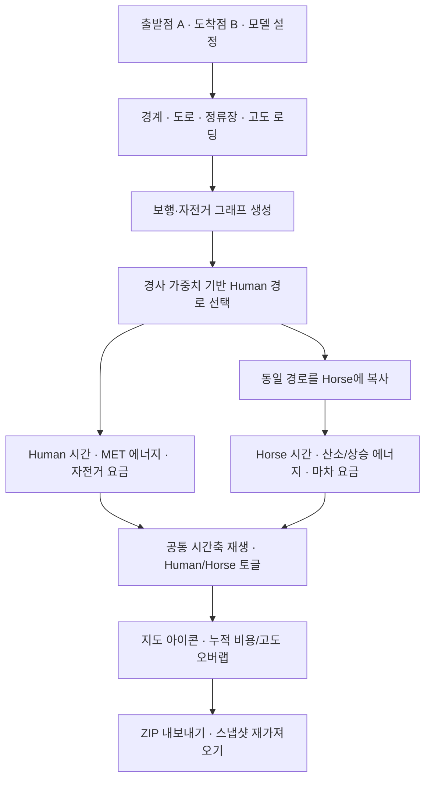

# Central Park Cost Distance — 시뮬레이션 구현 문서

- 작성일: 2026-10-29
- 구현 기준: 마차 요금 $72/20분 및 Facility Proximity 확장 반영. 초기 문서 기준 커밋은 `b7d6d75`이며 아래 확장 내용은 그 이후 구현이다.
- 프로젝트: `Hoonizzz/Spatial-Ai`의 `central-park/`
- 배포 주소: https://hoonizzz.github.io/Spatial-Ai/central-park/dist/
- 인터페이스 언어: 영어
- 문서 언어: 한국어

이 문서는 현재 구현된 센트럴파크 시뮬레이션의 목적, 구성 요소, 데이터, 파라미터, 계산식, 사용자 기능, 검증 범위와 한계를 설명한다. 초기 SoHo 3D 프로토타입 및 초기 첨부 명세와 구분하며, 현재 `dist/` 코드의 동작을 기준으로 작성했다.

> 핵심 구분: Human은 도보+전기자전거 이용자이고, Horse는 같은 경로를 말의 속도·대사 모델로 이동하는 에이전트다. Horse의 금전 비용은 마차 1대 요금이다. 말의 대사 모델에 마차·탑승자 무게를 추가한 것은 아니다.

## 1. 프로젝트 개요

**Central Park Cost Distance: 지형과 이동 주체에 따른 에너지·시간·비용 비교**

센트럴파크와 주변 1km에서 출발점 A와 도착점 B를 지정하고, 같은 경로를 이동하는 사람과 말의 시간·칼로리·금전 비용을 비교하는 웹 시뮬레이션.

## 2. 기획 목적과 연구 질문

- 평면 거리뿐 아니라 경사와 이동 주체를 고려하면 이동 비용은 어떻게 달라지는가?
- 같은 길에서도 사람과 말의 속도·대사 모델에 따라 시간과 에너지가 어떻게 달라지는가?
- 거리·시간·에너지·요금은 서로 다른 지표이며, 각각의 단위와 계산 기준을 구분한다.
- 비교 대상: Human = 도보+전기자전거 이용자 / Horse = 같은 경로를 이동하는 말. Horse의 금액만 마차 이용 요금으로 산정한다.
- 이는 시나리오 비교 도구이며, 실제 마차 운영 경로 또는 검증된 말 생리 예측 서비스라는 의미는 아니다.

## 3. 공간 범위와 데이터

| 요소 | 출처/형식 | 사용 목적 |
|---|---|---|
| 공원 경계 | NYC Open Data Parks Properties, M010 | 센트럴파크 경계, 주변 1,000m 분석 영역 |
| 길과 통행 태그 | OpenStreetMap / Overpass API | 실제 노드·도로 연결, 보행/자전거 허용 여부, 일방통행·회전 제한 |
| 수면 | OSM natural=water | 지도 배경 표현 |
| 자전거 정류장 | Citi Bike GBFS | 위치, 대여 가능한 전기자전거, 반납 도크, 상태 시각 |
| 지형 고도 | Mapzen Terrarium DEM / AWS Open Data | 도로 고도, 경사, 누적 상승고도 |
| 좌표 | 입력 WGS84 → 계산 UTM 18N(EPSG:32618) | 미터 단위 거리·경사 계산 |

도로는 7일 캐시, 공원 경계·DEM 타일도 브라우저 IndexedDB에 캐시한다. 정류장은 피드 TTL에 따라 최소 60초 간격으로 갱신한다. 대여/반납 판단에는 300초 이내 상태를 사용한다. 타임스탬프가 미래로 60초 이상 벗어난 레코드도 사용하지 않는다.

## 4. 사용자 입력과 화면 요소

- A/B: 장소 목록, 지도 클릭·마커 이동, 경도·위도 직접 입력, 출발/도착 교환.
- 모델 설정: 사람 체중·주행 속도·MET·도보 한도·추가 정지·요금 유형, 말 체중·속도·산소 소비 계수·상승 효율·마차 요금.
- 지도: 실제 도로, 정류장, 공유 이동 경로, 사람·말 아이콘, 고도에 따른 도로 색상.
- 결과: kcal, USD, 거리, 시간, 도보/주행 거리, 요금/대사 상세.
- Human/Horse 토글: 선택한 에이전트의 계산 결과와 그래프 표시. 경로가 없으면 해당 사유를 표시한다.
- Play/Pause/Reset, 재생속도 30×/60×/120×, 타임 슬라이더, 재계산.
- 결과 내보내기, 저장 데이터 가져오기, 실제 데이터 연결·예제 데이터 모드.

## 5. 이동 경로 계산

Human: A → 도보 → 대여 정류장 S → 전기자전거 → 반납 정류장 T → 도보 → B.

1. 실제 OSM 노드와 연결로 보행/자전거 그래프를 구성한다.
2. 각 끝에서 도보 한도 안에 있는 유효한 대여·반납 정류장 후보를 찾는다.
3. 자전거는 일방통행, 통행 금지, 회전 제한을 고려한다. 공원 내부 Drives 외에도 cycleway와 자전거 허용이 명시된 길을 포함한다. 보행 전용 길은 자전거 경로로 쓰지 않는다.
4. Dijkstra로 경사 가중 거리가 작은 후보와 빠른 후보를 계산한다.
5. 현재 기본 모드는 전체 여정의 실제 네트워크 거리 최소이며, 기존 경사 가중 거리 최소도 선택할 수 있다. 각 끝 기본 10개 후보를 사용하므로 후보 절단 시 경고가 표시된다. All 모드는 후보를 모두 검토한다. 별도 요금 비교는 거리/시간 후보 중에서 비교하며 전역 최저요금을 보장하지 않는다.
6. 지점은 허용 경로에 최대 50m까지 투영한다. 투영 연결 구간의 실제 접근 가능성은 검증되지 않았고, 그 거리도 본 경로에 합산되지 않는다.

Horse: 최종 선택된 Human 경로의 모든 보행·주행 구간을 그대로 복사한다. 별도의 승마 허용 네트워크로 우회하지 않는다. 이후 말 속도와 대사 모델로 시간·칼로리를 다시 계산한다. 사람 경로가 없으면 말 경로도 없다. 같은 형상이라도 같은 시각의 위치는 다를 수 있다.

## 6. 실제 지형과 경사 가중치

- DEM 타일: zoom 14, 픽셀 고도를 쌍선형 보간.
- 긴 도로 구간을 약 30m 이하 간격으로 나누어 고도를 적용한다. **30m 샘플 간격은 고도 데이터 정확도나 해상도가 30m라는 뜻이 아니다.**
- 경사 g = 높이 차이 / 수평 거리.
- 가중치 w = max(1, 18 × |g|).

| 경사 | 경사율 | 가중치 |
|---|---:|---:|
| 0 | 0% | 1 |
| 1/18 | 약 5.56% | 1 |
| 1/12 | 약 8.33% | 1.5 |
| 1/9 | 약 11.11% | 2 |

경로 비용 = Σ(구간 수평 거리 × w).
구간 시간(초) = 구간 수평 거리 ÷ (기준 속도 km/h ÷ 3.6) × w.

현재 모델은 오르막·내리막 모두 경사 절댓값으로 시간·경로 가중치를 적용한다. 말의 추가 중력 일은 오르막에만 더한다. 표시 거리는 수평 거리이며 가중 거리는 별도 지표다. 고도 로딩 실패를 실제 평지로 간주하지 않는다. 예제/기존 스냅샷의 고도 부재는 명시한다.

## 7. Human 파라미터

| 파라미터 | 기본값 | 조절 범위/규칙 |
|---|---:|---|
| 체중 | 70kg | 20–250kg |
| 자전거 기준 속도 | 15km/h | 5–24.14km/h; 구간 표면 속도와 사용자 설정 중 작은 값 |
| 보행 기준 속도 | 4.8km/h | 1–8km/h, 조절 가능; 경사에 따라 시간 증가 |
| 전기자전거 MET | 4.0 | 3–6 |
| 보행 MET | 3.5 | 1–8, 조절 가능 |
| 정지 MET | 1.3 | 고정 모델값 |
| 각 끝 도보 한도 | 800m | 100–2,000m |
| 대여 중 추가 정지 | 0분 | 0–120분 |
| 준비/반납 | 각각 30초 | 합계 60초 |
| 신호 대기 | 신호당 20초 | 모델 규칙 |
| 비포장 등 구간 기준 속도 | 10km/h | gravel/unpaved/cobblestone 태그에 적용 |
| 기본 요금 유형 | Single Ride | Day Pass / Annual / Pink / Reduced 선택 가능 |

자전거·보행 속도는 기준값이며 경사 가중치가 이동시간에 추가 반영된다. 말 속도는 6km/h 기본값이며 사용자가 설정할 수 있다. 경사와 관계없이 일정한 20km/h로 고정하는 기능은 적용하지 않는다.

## 8. Human 칼로리 모델

총 kcal = MET × 3.5 × 체중(kg) ÷ 200 × 시간(분).
활동 kcal = max(MET − 1, 0) × 3.5 × 체중 ÷ 200 × 시간.

보행·자전거·정지 구간별로 계산하여 합산한다. 경사는 이동시간 증가를 통해 반영한다. 자전거 MET 3–6에 대한 결과 범위도 표시하지만 통계적 신뢰구간이 아닌 민감도 범위다.

예: 70kg, 자전거 MET 4, 주행 10분 → 49kcal. 보행/정지 시간이 있으면 별도 합산한다.

## 9. Human 금전 비용

Citi Bike 증분 이용료 모델. 코드에 저장된 요금표이며 현재 공식 시세 재검증을 의미하지 않는다.

| 이용 유형 | 잠금 해제 | 전기자전거 분당 |
|---|---:|---:|
| Single Ride | $4.99 | $0.41 |
| Day Pass | $0 | $0.41 |
| Annual | $0 | $0.27 |
| Lyft Pink All Access | $0 | $0.27 |
| Reduced Fare | $0 | $0.14 |

- 전체 대여시간을 한 번 분 단위 올림한다.
- 선택한 경우 새 Day Pass 구매비 $25를 더한다.
- 기존 회원 가입비, 세금, 할인·프로모션은 합산하지 않는다.
- 30/45분 초과 시 장시간 요금 규칙 미검증 경고를 표시한다. 실제 장시간/초과 과금의 완전한 재현이 아니다.

## 10. Horse 파라미터와 대사 모델

| 파라미터 | 기본값 | 범위/단위 |
|---|---:|---|
| 말 체중 M | 500kg | 100–1,200kg |
| 평지 기준 속도 | 6km/h | 2–12km/h; 경사로 시간 증가 |
| 휴식 산소 소비 R | 3 | 1–10 ml O₂/kg/min |
| 이동 산소 비용 C | 0.10 | 0.01–1 ml O₂/kg/m |
| 오르막 효율 η | 0.25 | 0.10–0.40 |
| 산소의 에너지 환산 | 약 5kcal/L O₂ | 고정 근삿값 |
| 중력 가속도 | 9.80665m/s² | 고정 상수 |
| 열량 환산 | 4,184J/kcal | 고정 상수 |

R, C, η는 실험으로 보정한 말 생리 계수가 아닌 **조절 가능한 시나리오 가정**이다. 사람용 MET를 말에 재사용하지 않는다.

D: 수평 거리(m), T: 경사 반영 시간(분), H: 상승고도(m).

- 휴식 kcal = M × R × T × 5 / 1000.
- 이동 kcal = M × C × D × 5 / 1000.
- 오르막 kcal = M × 9.80665 × H / (η × 4184).
- 총 kcal = 휴식 + 이동 + 오르막.
- 활동 kcal = 이동 + 오르막.

예: 500kg, 6km/h, 평지 1km → 10분, 휴식 75 + 이동 250 = 총 325kcal. 이 예시는 공식의 단위 검증이며 실측 예측 정확도의 근거는 아니다.

말은 사람의 자전거 준비/반납·신호 대기 시간을 그대로 물려받지 않는다. 경로의 이동 구간을 자신의 속도로 이동한다.

## 11. 마차 금전 비용

사용자 제공 요금: **마차 1대당 시작한 20분마다 $72**.

T > 0일 때 비용 = $72 × ceil(T / 20분). T = 0이면 $0.

| 이용 시간 | 비용 |
|---|---:|
| 0분 | $0 |
| 0분 초과–20분 | $72 |
| 20분 초과–40분 | $144 |
| 40분 초과–60분 | $216 |

기본 20분 $72 + 추가 20분당 $72로 저장되어 있고 화면에서 수정 가능하다. 세금·팁은 별도로 더하지 않는다. 입력 출처는 user-provided이며 독립적인 시장 조사 검증을 완료한 값은 아니다. 사람은 1인 비용, 마차는 1대 비용이므로 직접적인 1인당 가격 비교에는 탑승 인원을 추가로 정해야 한다.

## 12. 시각화와 재생

- 현재 센트럴파크 앱은 SVG 기반 2D 지도와 고도 그래프다. 지형을 사용하지만 3D 지형 표면을 렌더링하는 것은 아니다.
- Human: 파란 원형 + 사람 실루엣 + HUMAN 라벨.
- Horse: 보라색 사각형 + 말 실루엣 + HORSE 라벨.
- 사람 경로 실선 위에 말 경로 점선을 겹쳐 같은 형상을 표시한다.
- 두 에이전트는 동시에 출발하고 각자의 속도·시간으로 이동한다. 먼저 도착한 에이전트는 기다리며 늦은 도착까지 재생한다.
- 공통 시간축에 누적 에너지/요금과 고도를 겹친다. 왼쪽 축은 kcal 또는 USD, 오른쪽 축은 m.
- Human/Horse 토글은 재생 시각을 유지하며 선택 에이전트의 결과를 보여준다.
- 요금은 연속 비례값이 아니라 과금 단위에 따라 단계적으로 증가한다.
- 이동 중 재계산하면 새 경로의 시작점에서 자동 재생한다. 일시정지/완료 상태에서는 계산 후 Play로 시작한다.

## 13. 기술 구성과 산출물

브라우저 JavaScript ES Modules, SVG, Web Worker, IndexedDB. GitHub Pages 정적 배포. 일반 실행에는 별도 패키지 설치나 API 키가 필요 없지만, 실데이터 연결은 외부 네트워크가 필요하다.

처리 흐름:
A/B·설정 → 경계/도로/정류장/고도 로딩 → 그래프 생성 → 사람 경로 선택 → 말이 동일 경로 재사용 → 개별 시간·대사·요금 계산 → 지도/오버랩 그래프 → 내보내기.

ZIP 산출물:
- result.json: 두 에이전트 결과, 선택 에이전트, 모델/요금 메타데이터.
- route.geojson: 선택한 에이전트의 경로.
- cumulative.csv: 경과 시간별 누적 kcal와 USD.
- snapshot.json: 데이터, 좌표, 설정값, 출처. 재가져오기 지원.

검증 현황: 이 문서 작성 전 구현 검증에서 Node 계산 테스트 24개와 Playwright 브라우저 검증이 통과했다. 문서 작성 과정에서 해당 검사를 다시 실행한 것은 아니다. 검증은 계산·동작의 일관성을 확인한 것이며 실제 말 대사 정확도나 모든 외부 데이터의 현재 접근성을 입증하는 것은 아니다.

## 14. 한계와 다음 단계

- 말 대사 계수의 연구/실측 보정 필요.
- 마차·탑승자·화물 무게가 말의 대사량에 추가 반영되지 않음.
- 말의 보법 전환, 피로, 온도, 노면별 운동 비용, 사료 요구량 미반영.
- 공유 사람 경로는 실제 마차의 합법적 운행 경로 또는 상품 투어 경로를 보장하지 않음.
- 고도 해상도 한계; 교량·터널·계단 등의 실제 주행 높이와 다를 수 있음.
- 현재 경사 비용은 사용자 정의 규칙이며 실제 속도 감소를 실측으로 보정한 식이 아님.
- 마차 요금은 사용자 제공값. 자전거 요금·장시간 규칙 최신 검증 필요.
- 사람 1인과 말 1마리의 총 kcal는 서로 다른 신체의 에너지이므로 값의 크기만으로 이동수단의 일반적 효율 우열을 결론내리지 않음.
- 실시간 정류장 정보는 도착 시 도크/자전거/배터리를 보장하지 않음.
- 도로·날씨·교통·공사·횡단보도 대기를 완전히 반영하지 않음.

후속 연구: 동물 대사 실측/문헌 보정, 마차 하중 반영, 승객 수 기준 비용 환산, 합법적 마차 운행 경로 데이터, 더 정밀한 고도, 여러 A/B·경사 조건의 민감도 분석.

## 15. 데이터와 가정의 근거 구분

| 종류 | 예 | 문서 표기 |
|---|---|---|
| 외부 지리/상태 데이터 | NYC 경계, OSM 길, DEM 고도, GBFS | 데이터 출처 명시 |
| 프로젝트 설계 규칙 | 공원 밖 1km, 경사 1/18, 같은 경로, 50m 투영 | 설계 조건/모델 규칙 |
| 사용자 지정값 | 말 500kg·6km/h, 마차 $72/20분 | 사용자 설정/입력 요금 |
| 미보정 시나리오 계수 | 말 R=3, C=0.10, η=0.25 | 가정값·미보정 |
| 저장 요금표 | Citi Bike 프로필 요율 | 코드 기준표·최신 확인 필요 |

## 16. 시스템 처리 흐름



### 비용의 세 가지 의미

이 문서와 구현에서 사용하는 cost는 문맥에 따라 다르므로 구분한다.

| 구분 | 계산 결과 | 단위 |
|---|---|---|
| 경로 탐색 비용 | 거리 × 경사 가중치의 합 | 가중 거리(m 상당 지표), 화폐 아님 |
| 대사 비용 | 휴식·활동 등에 소비되는 에너지 | kcal |
| 금전 비용 | 자전거 요금 또는 마차 요금 | USD |

마차 요금은 이동 시간이 20분 경계를 넘을 때 계단식으로 증가한다. 이동 에너지와 금전 비용은 같은 비율로 증가하는 값이 아니다.

## 17. 실행 방법

현재 앱은 정적 파일로 실행할 수 있으며 별도 빌드나 API 키가 필요하지 않다. 실데이터 조회에는 네트워크 연결이 필요하다.

### 저장소 전체를 정적 서버로 실행

```sh
cd /workspace/Spatial-Ai
python3 -m http.server 8000
```

브라우저에서 서버의 `/central-park/dist/` 경로에 접속한다. Python 서버는 개발·검증용이며 GitHub Pages는 같은 정적 파일을 배포한다.

### 제공된 Node 개발 서버 사용

```sh
cd /workspace/Spatial-Ai/central-park
npm run dev
```

Node.js 22 이상을 기준으로 하며 기본 포트는 4173이다. 일반 브라우저 화면은 자체적으로 외부 데이터를 읽는 정적 앱이다. 제공된 개발 서버의 별도 `/api/` 기능은 이 문서에서 설명한 최신 두 에이전트 화면과 별도의 경로이며, 최신 Horse 기능의 검증 대상으로 간주하지 않는다.

### 검증 명령

```sh
cd /workspace/Spatial-Ai/central-park
npm test
npm run check
```

브라우저 검증에는 Python Playwright와 Chromium이 필요하다. 저장소 루트에서 8000번 정적 서버를 실행한 상태로 다음을 수행한다.

```sh
cd /workspace/Spatial-Ai
python3 central-park/tests/terrain_browser.py
python3 central-park/tests/recalculation_browser.py
```

브라우저 테스트는 제어된 합성 데이터와 DEM 테스트 이미지를 사용한다. 테스트 통과는 실제 센트럴파크 현장 통행 또는 생리 모델 실측 보정을 의미하지 않는다.

## 18. 주요 파일과 역할

| 파일 | 역할 |
|---|---|
| `dist/index.html` | 화면, 입력 필드, Human/Horse 토글, 지도·그래프 영역 |
| `dist/style.css` | 반응형 레이아웃, 에이전트 스타일, 접근성·모션 설정 |
| `dist/app.js` | 입력, 상태 관리, 재계산, 재생, 지도·그래프, 내보내기 |
| `dist/engine.js` | 좌표 변환, 그래프, Dijkstra, 경사 비용, Human 에너지·요금 |
| `dist/horse.js` | 공유 경로의 말 시간·대사·마차 요금 계산 |
| `dist/worker.js` | 그래프 생성과 경로 계산을 Web Worker에서 실행 |
| `dist/data.js` | NYC·OSM·GBFS 데이터 조회, 정규화, 캐시 |
| `dist/terrain.js` | DEM 타일 조회·해독·보간, 도로 고도 부여 |
| `dist/example.js` | 실데이터와 구분되는 합성 예제 |
| `dist/zip.js` | ZIP 내보내기 |
| `tests/engine.test.mjs` | 현재 센트럴파크 기본 계산 테스트 |
| `tests/horse.test.mjs` | 말 대사, 공유 경로, 마차 과금 경계 테스트 |
| `tests/terrain_browser.py` | 지도·토글·고도·에너지·요금·내보내기 통합 검증 |
| `tests/recalculation_browser.py` | 중복 재계산 및 재생 복구 회귀 검증 |

위 파일 경로는 `central-park/` 기준이다. 저장소 루트의 과거 SoHo 앱 테스트와 혼동하지 않는다.

## 19. 출처 및 재현 정보

- 현재 계산 구현: [engine.js](../dist/engine.js), [horse.js](../dist/horse.js)
- 데이터 처리: [data.js](../dist/data.js), [terrain.js](../dist/terrain.js)
- 말 모델 상세: [horse-model.md](horse-model.md)
- NYC Parks: https://data.cityofnewyork.us/d/enfh-gkve
- OSM 데이터: https://www.openstreetmap.org/
- Citi Bike 데이터 안내: https://citibikenyc.com/system-data
- Citi Bike 요금 안내: https://citibikenyc.com/plans-and-pricing
- DEM 데이터 안내: https://registry.opendata.aws/terrain-tiles/
- 마차 요금 출처: 사용자가 제공한 “20분마다 72달러”. 마차 1대 기준으로 저장.

외부 링크는 사용 데이터·요금 관련 출처를 가리킨다. 문서 작성 시 해당 페이지의 최신 내용이나 요금을 다시 검증했다는 의미는 아니다. 데이터 조회 시각, 설정값과 요금 출처는 내보낸 JSON/스냅샷을 통해 함께 보존한다.

## 20. Facility Proximity 확장

시설의 도보 네트워크 접근성과 조회 시점의 대여·반납 가능성을 분리하는 확장 구조는 [PROXIMITY.ko.md](PROXIMITY.ko.md)에 정의한다. 원본 시뮬레이션의 사람·말 공유 경로와 대사·요금 계산을 유지하며, 시설 분류 임계값과 실제 경로의 접근 제한을 별도로 관리한다. 이 확장부터 실제 네트워크 거리 최소와 기존 경사 가중 거리 최소를 명시적으로 선택한다. 이후 변경사항은 확장 문서를 우선한다. 시설의 5분 임계값은 분류용이며 후보를 제거하지 않는다. 3/5/10분 네트워크 도달 레이어, 상태 심볼·inspector·직접 도보 비교표, 후보 절단 경고를 제공한다. 최신 계산 검증은 35개 테스트가 통과했으며 외부 GBFS 실연결은 HTTP 403으로 미검증 상태다.
