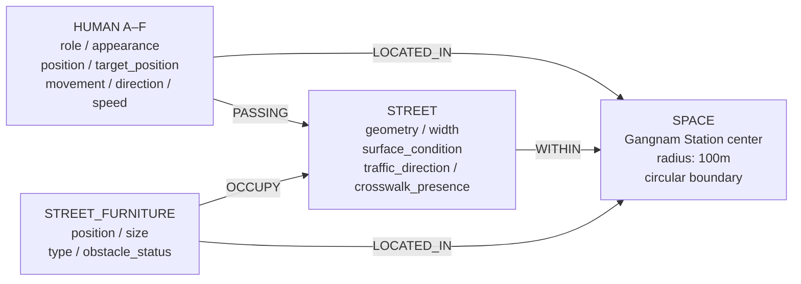

# Neighborhood — Gangnam Station 100m Boundary

This document specifies the spatial model and interaction requirements for the visualization.

## Application requirements

- A simple single-page web application using vanilla JavaScript.
- A three.js rendered primary view that fills the browser window.
- The space is a circular neighborhood centered on Gangnam Station with a **100-meter radius**, rather than a single street.
- Show the station center, a labeled 100m boundary, streets, traversable surfaces, and street furniture.
- Render six individually identifiable people, labeled **A–F**, with the appearances below.
- Allow the user to select each person and click a location within the space to move that person.

## Spatial boundary

- `center`: Gangnam Station center; use a single verified geographic reference point consistently when geographic data is available.
- `radius_m`: `100` (diameter: 200m).
- Use a local metric coordinate system with the station center at `(x, z) = (0, 0)` and one scene unit representing one meter.
- A point lies inside the boundary when `x² + z² <= 100²`.
- Streets are surfaces **within** the neighborhood; they no longer define the whole space.
- If geographic data is unavailable, label the visualization as a schematic of the Gangnam Station 100m area. Do not present invented street geometry as a surveyed map.

## Entities

### SPACE

- **id**: `gangnam_station_100m`
- **center**
- **radius_m**: `100`
- **boundary**: circular
- **coordinate_system**: local metric coordinates

### HUMAN

- **id**: unique and persistent; one of `A`, `B`, `C`, `D`, `E`, `F`
- **role**: office_worker or tourist
- **appearance**: clothing and accessories
- **position**
- **target_position**
- **movement**
- **direction**
- **speed**
- **selected**

| Identifier | Role | Clothing | Accessories |
| --- | --- | --- | --- |
| A | Office worker | Business suit, dress shirt, tailored trousers | Tie and dress shoes |
| B | Office worker | Business suit, dress shirt, tailored trousers | Tie and dress shoes |
| C | Office worker | Business suit, dress shirt, tailored trousers | Tie and dress shoes |
| D | Tourist | Hawaiian shirt and casual bottoms | Backpack and casual shoes |
| E | Tourist | Hawaiian shirt and casual bottoms | Backpack and casual shoes |
| F | Tourist | Hawaiian shirt and casual bottoms | Backpack and casual shoes |

Use distinct colors while preserving the required clothing style. Keep each identifier visible above its person and show a clear highlight for the selected person.

### STREET

- **id**
- **geometry**
- **width**
- **surface_condition**
- **traffic_direction**
- **crosswalk_presence**
- **traversable_surfaces**

### STREET_FURNITURE

- **id**
- **position**
- **size**
- **type**
- **obstacle_status**

## Relationships

- **HUMAN → SPACE**: `LOCATED_IN`
- **STREET → SPACE**: `WITHIN`
- **STREET_FURNITURE → SPACE**: `LOCATED_IN`
- **HUMAN → STREET**: `PASSING`, when using a street surface.
- **STREET_FURNITURE → STREET**: `OCCUPY`, when placed on a street surface.

## Rules

- Every person and their collision footprint must remain inside the Gangnam Station 100m boundary during movement.
- People must remain on traversable surfaces and avoid furniture with `obstacle_status = true`.
- Movement must respond to street geometry, surface conditions, traffic direction, and crosswalk availability.
- Starting positions for all six people must be valid and distinct.
- IDs, roles, clothing, and accessories persist when positions change.
- Movement must use a valid route entirely inside the boundary. A valid destination alone does not make a route valid.

## Mouse interaction

1. Click a person or their identifier label to select them. Toolbar buttons A–F provide an alternative selection method.
2. Highlight the selected person and display their identifier and role.
3. With a person selected, click a traversable location inside the boundary to set their destination. Use three.js raycasting against the ground surfaces to obtain the destination in scene coordinates.
4. Validate the destination against the boundary, the person's collision footprint, traversability, and obstacles. Show a destination marker and move only the selected person along a valid route.
5. Update position, direction, and movement state during motion. Stop at the destination.
6. A new valid click replaces that person's previous destination. Other people retain their current states and destinations.
7. Reject clicks outside the boundary, on obstacles, on non-traversable surfaces, or at unreachable locations. Preserve the previous valid destination and show a brief reason.
8. A click without a selected person prompts the user to select A–F first. Camera dragging must not trigger a destination click.

## Actions

- `SELECT`: select a person by identifier or scene click.
- `MOVE`: move the selected person to a valid clicked destination.
- `TURN`: change direction while remaining within the movement rules.
- `STOP`: stop the selected person and clear their destination.
- `AVOID`: avoid an obstacle on a route.
- `REROUTE`: find an alternative valid route; stop and report if no route is available.

## Semantic Model Diagram



## Compact Machine-Readable Representation

```yaml
space:
  id: gangnam_station_100m
  center: Gangnam Station
  radius_m: 100
  boundary: circular
  coordinate_system: local_metric
  scene_units_per_meter: 1

entities:
  human:
    attributes: [id, role, appearance, position, target_position, movement, direction, speed, selected]
    instances:
      - {id: A, role: office_worker, clothing: business_suit, accessories: [tie, dress_shoes]}
      - {id: B, role: office_worker, clothing: business_suit, accessories: [tie, dress_shoes]}
      - {id: C, role: office_worker, clothing: business_suit, accessories: [tie, dress_shoes]}
      - {id: D, role: tourist, clothing: hawaiian_shirt, accessories: [backpack, casual_shoes]}
      - {id: E, role: tourist, clothing: hawaiian_shirt, accessories: [backpack, casual_shoes]}
      - {id: F, role: tourist, clothing: hawaiian_shirt, accessories: [backpack, casual_shoes]}
  street:
    attributes: [id, geometry, width, surface_condition, traffic_direction, crosswalk_presence, traversable_surfaces]
  street_furniture:
    attributes: [id, position, size, type, obstacle_status]

relationships:
  - {subject: human, relation: located_in, object: space}
  - {subject: street, relation: within, object: space}
  - {subject: street_furniture, relation: located_in, object: space}
  - {subject: human, relation: passing, object: street}
  - {subject: street_furniture, relation: occupy, object: street}

rules:
  - Human collision footprints and movement routes must remain inside the 100m boundary.
  - Humans must remain on traversable surfaces and avoid blocking furniture.
  - Human identifiers and appearances persist through movement.
  - Invalid destination clicks preserve the previous valid destination.

interaction:
  selection: click_person_or_label_or_identifier_button
  destination: click_traversable_ground_inside_boundary
  position_mapping: three_js_raycast
  movement: follow_valid_route_to_destination
  camera_drag_sets_destination: false

actions: [select, move, turn, stop, avoid, reroute]
```

## Acceptance checks

- The displayed space has a radius of 100 scene units around the station center.
- A–C appear as office workers in business suits; D–F wear Hawaiian shirts and visible backpacks.
- All six identifiers are unique and readable, and each person can be selected independently.
- Selecting each of A–F and clicking a valid destination moves only that person to the requested position.
- Invalid destinations and unreachable routes are rejected without crossing the boundary or obstacles.
- Selecting a different person does not alter another person's identity or destination.
- Camera dragging does not move a person.
- STOP halts the selected person and clears their target.
