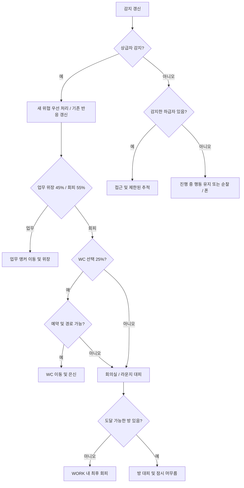

# Office Hierarchy — 3D 공간 에이전트 시뮬레이션 통합 구현 명세

- 문서 버전: 3.0 통합본
- 작성일: 2026-11-05
- 기준 구현: `Hoonizzz/Spatial-Ai`, 커밋 `dd5a7ee`
- 공개 실행 주소: https://hoonizzz.github.io/Spatial-Ai/
- 목적: 현재 구현된 시뮬레이션을 다른 개발자 또는 코딩 에이전트가 재구현할 수 있도록 구조·수치·규칙·검증 기준을 한 문서에 정의한다.
- 문서 언어는 한국어이며, 제품의 UI·버튼·로그·상태 설명은 영어로 작성한다.

이 문서는 초기 22명 고정·308㎡·2D 명세와 이후 변경 사항을 통합한 현재 기준이다. 원본 초기 명세는 이력 자료이며, 현재 구현을 다시 만들 때는 본 문서의 인원수 조절, 616㎡ 공간, 축소된 기본 시야 반경, 블록형 3D 화면 및 예측 회피 규칙을 적용한다.

## 1. 프로젝트 개념과 범위

사무실에서 직급별 주의 반경과 위계 반응이 이동·감시·업무 위장·회피·공간 점유에 미치는 영향을 관찰하는 브라우저 기반 시뮬레이션을 만든다.

상급자는 보이는 하급자에게 접근하고, 하급자는 보이는 상급자에 반응해 업무를 하는 척하거나 화장실·회의실·라운지로 이동한다. 상급자 감지에 따른 반응은 하급자 추적보다 우선한다.

이는 설정된 규칙에 따른 가상 실험이다. 직급별 반경은 생리적 시력 차이가 아니라 사회적 주의·경계심을 표현하는 가정이다. 확률·속도·행동은 실제 직장인 조사나 검증된 예측 모형의 결과로 제시하지 않는다.

### 필수 구현 범위

1. 직급별 인원수 조절 및 안전한 초기 배치.
2. 동일 시야각, 직급별 주의 반경, 벽·가구 차폐.
3. 상급자 접근과 하급자 위장·도주를 처리하는 상태 기계.
4. 문을 통과하는 A* 경로, 예측 교행·양보 및 신체 충돌 방지.
5. 예약을 포함한 WC 정원 4명과 회의실·라운지 대피.
6. 블록형 3D 인물, 전체 시야 표시, 2D 평면 보기와 카메라 조작.
7. 랜덤 리셋, seed 재현, 통계·히트맵·CSV·JSON 내보내기.
8. 다중 seed 실험, 자동 검증, GitHub Pages 메인 페이지 배포.

### 구현하지 않는 기능

실제 조직 행동의 학습·보정, 층간 이동, 점프·중력 기반 인체 물리, 음성·청각 감지, 실시간 외부 데이터, 사용자 계정·백엔드·DB는 포함하지 않는다. 이동 논리는 2D이고 3D 화면은 이를 표현한다.

## 2. 기술 스택과 파일 구조

| 구성 | 기준 |
|---|---|
| 언어 | TypeScript, strict 타입 검사 |
| 개발·빌드 | Vite 7 계열, TypeScript 5.9 계열 |
| 3D | Three.js 0.180 계열, WebGLRenderer, OrbitControls |
| 2D | HTML Canvas 2D |
| 논리 시간 간격 | 고정 `dt = 0.05 s` |
| 화면 갱신 | `requestAnimationFrame` |
| 경로 탐색 | 0.25m 격자, 8방향 A*, 유클리드 휴리스틱 |
| 실험 처리 | 별도 Web Worker |
| 단위 검사 | Node.js test runner + tsx |
| 브라우저 검사 | Python Playwright + Chromium |
| 배포 | 정적 HTML·CSS·JS, GitHub Pages |

현재 개발 환경은 Node.js 24에서 검증했다. Vite 실행에는 Node.js 22.12 이상을 사용하고, 의존성의 정확한 버전은 `package-lock.json`으로 고정한다. 런타임에는 API 키·서버·CDN이 필요하지 않다.

```text
office-hierarchy-sim/
├─ index.html
├─ package.json
├─ package-lock.json
├─ tsconfig.json
├─ vite.config.ts
├─ README.md
├─ scripts/
│  └─ publish-home.mjs
├─ src/
│  ├─ main.ts                  # UI, 시간 루프, 선택, 출력
│  ├─ config.ts                # 기본값, 직급, 시나리오, seeded RNG
│  ├─ types.ts                 # Agent, Config, State, Event
│  ├─ reset.ts                 # 새 seed 생성
│  ├─ simulation.ts            # 행동 판단, 고정 step, 통계
│  ├─ style.css
│  ├─ world/
│  │  ├─ floorplan.ts          # 방, 문, 장애물, 좌표
│  │  ├─ navigation.ts         # A*, 동적 장애물, 평활화
│  │  └─ occupancy.ts          # WC 예약·점유·슬롯
│  ├─ agents/
│  │  ├─ spawn.ts
│  │  ├─ perception.ts
│  │  └─ movement.ts
│  ├─ render/
│  │  ├─ scene.ts              # 3D, 인물, 카메라, 화질
│  │  ├─ canvas.ts             # 2D 평면 보기
│  │  └─ vision.ts             # 공유 시야 부채꼴 투영
│  ├─ experiment-core.ts
│  ├─ experiment-worker.ts
│  └─ experiment.ts            # CLI 실험
├─ tests/
│  ├─ model.test.ts
│  ├─ population-avoidance.test.ts
│  └─ browser.py
├─ docs/
│  └─ OFFICE_HIERARCHY_REBUILD_SPEC.ko.md
└─ dist/                       # GitHub Pages 배포 파일
```

## 3. 에이전트와 인원수

| 직급 | 코드 | rank | 기본 인원 | 주의 반경 | 색상 |
|---|---|---:|---:|---:|---|
| 사장 | `CEO` | 4 | 1 | 3m | `#ac4b32` |
| 팀장 | `LEAD` | 3 | 3 | 2.5m | `#946524` |
| 대리 | `ASSOCIATE` | 2 | 6 | 3.5m | `#286d78` |
| 신입 | `JUNIOR` | 1 | 12 | 4.5m | `#6653a3` |

- 기본 총원은 22명이다. 직급별 **0~40명**, 전체 **최대 120명**을 허용한다.
- 정수가 아닌 값, 음수, 직급별 상한 또는 총원 상한 초과는 설정 적용 전에 거부한다.
- 0명인 직급, 여러 명의 사장, 모든 직급이 0명인 빈 사무실을 지원한다.
- 동일 직급은 위계 이벤트를 만들지 않는다. 교통 회피에서는 직급과 무관하게 서로 비킨다.
- 인원수가 바뀌면 3D 인물·시야·선택 목록·범례·통계·내보내기 데이터도 함께 바뀐다.
- 제거된 에이전트의 그래픽과 전용 geometry·material·texture를 정리한다. 공유 자원은 유지한다.
- 선택한 사람이 사라지면 남아 있는 첫 사람을 선택한다. 0명이면 선택을 비활성화한다.
- 책상은 공유 시설 22개로 유지하며, 인원수에 비례해 늘리거나 개인 자리를 지정하지 않는다.

### 신체와 속도

물리 반경은 모든 직급에서 0.30m, 최소 중심 간격은 0.60m다. 초기 배치는 0.75m 이상을 확보한다.

속도 단계 `L`의 기본 물리 속도는 다음과 같다.

```text
v = 0.5 × L × speedMultiplier  [m/s]
```

| 직급 | 기본 단계 / 속도 | 하급자 접근 단계 / 속도 | 회피 단계 / 속도 |
|---|---|---|---|
| CEO | 1 / 0.5m/s | 2 / 1.0m/s | 해당 없음 |
| LEAD | 2 / 1.0m/s | 3 / 1.5m/s | 4 / 2.0m/s |
| ASSOCIATE | 2 / 1.0m/s | 3 / 1.5m/s | 4 / 2.0m/s |
| JUNIOR | 3 / 1.5m/s | 해당 없음 | 5 / 2.5m/s |

표의 속도는 배율 1일 때의 희망 속도다. 실제 이동 속도는 정지·양보·충돌 회피에 따라 낮아질 수 있다. 프레젠테이션에서 희망 속도와 평균 실제 속도를 구분한다.

## 4. 기본 설정과 UI 파라미터

```json
{
  "counts": { "CEO": 1, "LEAD": 3, "ASSOCIATE": 6, "JUNIOR": 12 },
  "seed": 42,
  "fov": 110,
  "radii": { "CEO": 3, "LEAD": 2.5, "ASSOCIATE": 3.5, "JUNIOR": 4.5 },
  "pretendProbability": 0.45,
  "wcEscapeProbability": 0.25,
  "wcCapacity": 4,
  "avoidanceDuration": 2,
  "pursuitDuration": 8,
  "speedMultiplier": 1,
  "desksBlockSight": false,
  "openVisibility": false,
  "closeReevaluate": false
}
```

| 조절 항목 | 기본값 | UI 범위 / 의미 |
|---|---:|---|
| 직급별 인원수 | 1 / 3 / 6 / 12 | 각각 0~40, 정수, 총원 ≤120 |
| seed | 42 | 0~4,294,967,295, 정수 |
| 전체 공통 시야각 | 110° | 30~180°, 5° 단위 |
| 직급별 주의 반경 | 3 / 2.5 / 3.5 / 4.5m | 각각 1~15m, 0.5m 단위 |
| 업무 위장 확률 | 45% | 0~100% |
| 회피 중 WC 선택 비중 | 25% | 0~100%, 전체 행동 대비 비율이 아님 |
| 속도 배율 | 1 | 0.25~2, 0.25 단위 |
| 최소 회피 시간 | 2s | 2~20s, 0.5s 단위 |
| 추적 상한 | 8s | 1~30s, 0.5s 단위 |
| WC 정원 | 4명 | 일반 UI에서는 잠금, 폐쇄 실험에서 0 |
| 책상 시선 차폐 | OFF | 낮은 책상의 시선 차폐 여부 |
| 근접 업무 재평가 | OFF | 가까운 상급자 앞에서 추가 도주 실험 |
| 시뮬레이션 시간 배속 | 1× | 1× / 2× / 4× |
| 렌더 화질 | High | Balanced / High / Ultra |
| 실험 seed 수 | 20 | 20~100 |
| 실험 1회 가상 시간 | 60s | UI 10~1,800s, 10s 단위 |

인원수·물리·행동 설정은 `Apply settings & restart`로 적용한다. 화질·레이어·선택·카메라 변경은 실행 시간이나 seed를 초기화하지 않는다.

## 5. 공간과 좌표계

### 전체 크기

```text
s = √2
WIDTH  = 22s = 약 31.1127m
HEIGHT = 14s = 약 19.7990m
AREA   = 616㎡
```

이는 초기 308㎡에서 **면적 기준 2배**다. 가로·세로를 각각 2배로 늘리는 4배 면적 확장이 아니다.

논리 좌표 `(x,y)`의 원점은 좌하단이고 단위는 m다. 3D에서는 다음과 같이 매핑한다.

```text
X = x
Y = 모델의 높이
Z = HEIGHT - y
인물의 Y축 회전 = heading + π/2
```

### 구역 배치

아래는 확대 전 기준 좌표다. 모든 구역의 좌표와 크기에 `s`를 곱해 실제 좌표로 사용한다.

| 구역 | 기준 범위 `(xmin,ymin)-(xmax,ymax)` | 현재 면적 |
|---|---|---:|
| WORK | `(0,0)-(14,11)` | 308㎡ |
| MEETING | `(14,7)-(22,14)` | 112㎡ |
| LOUNGE | `(14,0)-(22,7)` | 112㎡ |
| WC | `(0,11)-(7,14)` | 42㎡ |
| CORRIDOR | `(7,11)-(14,14)` | 42㎡ |

### 문과 벽

문 위치·폭에도 `s`를 곱한다. 문 개구부 외에는 벽을 통과할 수 없다.

| 연결 | 기준 중심 | 기준 폭 |
|---|---|---:|
| WORK ↔ CORRIDOR | `(11,11)` | 1.5m |
| CORRIDOR ↔ WC | `(7,12.5)` | 1.2m |
| CORRIDOR ↔ MEETING | `(14,12.5)` | 1.2m |
| WORK ↔ MEETING | `(14,9)` | 1.5m |
| WORK ↔ LOUNGE | `(14,3.5)` | 1.5m |
| LOUNGE ↔ MEETING | `(19,7)` | 1.5m |

내부 벽은 기준 두께 0.12m의 직사각형으로 구성한 뒤 확대한다. 3D 벽은 내부가 보이는 낮은 표현으로 그리지만, 논리적인 차폐·통행 판정은 별도로 유지한다.

### 책상과 시설의 재현 배치

책상은 4열에 6 / 6 / 5 / 5개로 배치한다. 가구의 중심 위치만 확대하고, 가구 자체 크기와 인체 반경은 유지한다.

```text
col = 0..3
row = 0..5 (col 0,1), 0..4 (col 2,3)
xBase = 1.3 + 3col
yBase = 0.8 + 1.7row

desk.x = (xBase + 0.6)s - 0.6
desk.y = (yBase + 0.3)s - 0.3
desk.w = 1.2
desk.h = 0.6
workAnchor = (desk.x + 0.6, desk.y + 1.05)
```

| 가구 | 확대 전 기준 직사각형 `(x,y,w,h)` |
|---|---|
| 회의 테이블 | `(16,9,4,2)` |
| 서쪽 소파 | `(15.8,1.2,0.8,3)` |
| 동쪽 소파 | `(20.5,1.2,0.8,3)` |
| 라운지 테이블 | `(18,2,1.6,1.4)` |
| WC 칸막이 3개 | `x=2.05 / 3.55 / 5.05`, `y=13.1,w=0.1,h=0.9` |

일반 가구 변환은 `(x+w/2)s-w/2`, `(y+h/2)s-h/2`로 위치를 계산하고 `w,h`는 유지한다.

WC 은신 슬롯은 `(1.3,12.5)`, `(2.8,12.5)`, `(4.3,12.5)`, `(5.8,12.5)`에 각각 `s`를 곱한다. 라운지 앵커 기준점은 `(17.2,1.5)`, `(17.2,3.5)`, `(19.9,1.5)`, `(19.9,3.5)`, `(18,5.5)`, `(20,5.5)`다. 장식용 의자는 별도의 충돌 장애물로 가정하지 않는다.

## 6. 초기 배치와 재현성

직급 순서 `CEO → LEAD → ASSOCIATE → JUNIOR`, 각 직급 내 번호 순으로 생성한다. ID는 `CEO-1`, `LEAD-1` 등으로 구성한다.

| 직급 | 반복 사용하는 초기 방 패턴 |
|---|---|
| CEO | WORK, 상부 `y > 7.5s` |
| LEAD | WORK, WORK, MEETING |
| ASSOCIATE | WORK ×4, LOUNGE, MEETING |
| JUNIOR | WORK ×9, LOUNGE ×2, MEETING |

인원수가 패턴 길이를 넘으면 패턴을 반복한다. 해당 방의 통행 가능한 nav cell에서 무작위로 위치를 선택하고, 기존 인원과 0.75m 이상 떨어진 후보만 채택한다. 최대 10,000회 안에 배치하지 못하면 오류를 반환하며 겹치는 사람을 억지로 생성하지 않는다. 초기 heading도 seeded RNG로 정한다. WC 시작 점유는 0명이다.

현재 구현과 같은 결과가 필요하면 `config.ts`의 Mulberry32 방식 seeded RNG와 동일한 호출 순서를 사용한다. 정렬·생성 순서와 고정 timestep도 일관되게 유지한다.

```ts
function seededRandom(seed: number) {
  let n = seed >>> 0;
  return () => {
    n += 0x6D2B79F5;
    let t = n;
    t = Math.imul(t ^ (t >>> 15), t | 1);
    t ^= t + Math.imul(t ^ (t >>> 7), t | 61);
    return ((t ^ (t >>> 14)) >>> 0) / 4294967296;
  };
}
```

- `Random reset`: `crypto.getRandomValues`로 새로운 uint32 seed를 얻고, 이전 seed와 같으면 다른 값으로 보정한다. 입력란도 갱신한다.
- `Replay seed`: 입력한 seed와 현재 적용된 모델 설정으로 초기화한다.
- 설정 적용: 표시된 seed를 유지하며 새 설정을 적용한다.
- 랜덤 리셋은 실행/일시정지 상태와 카메라 방향을 유지한다.
- 내보낸 JSON은 보고서이며, 실행 중인 상태를 그대로 재개하는 checkpoint 형식은 아니다.

## 7. 데이터 모델

에이전트에는 최소한 다음 정보가 필요하다. 방향 단위는 radian이다.

```ts
type Role = 'CEO' | 'LEAD' | 'ASSOCIATE' | 'JUNIOR';
type Room = 'WORK' | 'MEETING' | 'LOUNGE' | 'WC' | 'CORRIDOR';
type Point = { x: number; y: number };
type State =
  | 'WANDER' | 'PHONE' | 'APPROACH' | 'PRETEND_WORK'
  | 'FLEE_TO_WC' | 'WC_HIDE'
  | 'FLEE_TO_ROOM' | 'ROOM_HIDE'
  | 'FLEE_IN_OFFICE' | 'COOLDOWN';
```

| 필드 묶음 | 주요 필드 |
|---|---|
| 신원·물리 | `id, role, rank, x, y, heading, radius, velocity, speedLevel` |
| 시야 | `fovDeg, visionRangeM, seen, stable, superiorIds, inferiorIds` |
| 목표·경로 | `targetAgentId, targetPoint, targetRoom, path, lastPlan` |
| 반응 안정화 | `episode, reactionMode, lastThreatPlan, lastSeenSuperiorAt` |
| 시간·상태 | `state, stateStartedAt, until, arrivedAt, lastTargetSeen` |
| 교통·WC | `stuck, pursuitCooldowns, wcReservation` |
| 기록 | `trail, distance, movingTime, stateTime, events, superiorTime, ceoDistance, roomTime` |

`seen`은 감지 시작 및 마지막 가시 시각, `stable`은 안정화된 감지 대상 집합을 보관한다. `reactionMode`는 같은 위협에 대한 업무 위장/회피 선택을 재사용하기 위한 값이다. 프레임마다 이 확률을 다시 추첨하지 않는다.

## 8. 시야 판정

관찰자 A가 B를 보는지는 **A의** 시야와 방향으로 계산한다. 두 사람의 상호 감지는 별개다.

```text
d = |B - A|
f = (cos headingA, sin headingA)
u = (B - A) / d

canSee(A,B) =
  A.id != B.id
  AND d <= A.visionRangeM
  AND dot(f,u) >= cos(A.fovDeg / 2)
  AND A→B 사이에 시선 차폐 장애물이 없음
```

- 벽과 일반 가구는 시선을 차폐한다.
- 책상은 기본적으로 시선을 차폐하지 않으며 옵션으로 바꿀 수 있다.
- 다른 사람의 신체 자체는 시선 차폐 장애물로 처리하지 않는다.
- High visibility 프리셋에서는 내부 벽이 시각적으로 투명한 것으로 계산한다. 물리 통행 벽은 유지한다.
- 0.15초 연속 관측 후 감지를 확정하고, 사라진 뒤 0.7초 유예를 적용한다.
- 감지 통계와 inspector는 유예를 포함한 안정화 감지를 사용한다.
- 모든 에이전트의 FOV 부채꼴을 기본 표시한다. `All FOV`를 끄면 선택한 사람만 표시할 수 있다.
- 부채꼴도 실제 차폐와 공간 외곽에 맞춰 ray clipping한다. 2D와 3D가 동일한 함수를 사용한다.

## 9. 행동 상태와 우선순위

| 상태 | 행동 | 주요 종료·전환 조건 |
|---|---|---|
| WANDER | 방 사이의 자율 순찰 | 상급자 또는 하급자 감지, 목표 도착 |
| PHONE | 느리게 걷거나 1~3초 정지하며 폰 행동 | 상급자 감지 우선, 약 3초 후 순찰 |
| APPROACH | 감지한 하급자 추적 | 1.2m 도달, 8초 상한, 2초간 타깃 상실 |
| PRETEND_WORK | 접근 가능한 업무 앵커로 이동 후 업무 모션 | 위협 해제 및 유지 시간 종료, 장기 정체 방지 상한 |
| FLEE_TO_WC | 예약한 WC 슬롯으로 이동 | 슬롯 도착, 예약 실패·만료·경로 실패 |
| WC_HIDE | WC 슬롯 은신 | 4~8초 만료 또는 새 상급자로 은신처 노출 |
| FLEE_TO_ROOM | 회의실·라운지 대피 지점으로 이동 | 목적지 도착 또는 경로 재계산 |
| ROOM_HIDE | 대피한 방에서 잠시 머무름 | 4~8초 만료 또는 위협 재감지 |
| FLEE_IN_OFFICE | 업무공간 내 최후 회피 | 최소 회피 시간 및 위협 상실 안정화 |
| COOLDOWN | 반응 직후 잠시 대기 | 1~2초 만료, 새 위협은 중단 가능 |



이 그림은 신규 반응의 개념 흐름이다. 실제 구현은 진행 중인 이동·은신·cooldown을 상태별 조건에 따라 유지한다.

### 우선 대상과 방향 전환

1. 감지한 상급자 중 rank가 가장 높은 사람을 선택한다. 동급이면 가까운 사람, 거리도 같으면 ID 순으로 정한다.
2. 새 위협 처리를 기존 상태의 `return`보다 먼저 수행한다. 이미 도주 중이라는 이유로 새 사장을 무시하지 않는다.
3. 더 높은 rank의 새 위협은 바로 우선 처리한다. 같은 rank 사이의 목표 변경은 최소 0.5초 간격을 둔다.
4. 같은 위협 앞에서 WANDER·PHONE·APPROACH로 돌아오면 이전 `reactionMode`를 재사용한다.
5. 상급자 대응이 없을 때만 가장 가까운 감지 하급자에게 접근한다.
6. CEO는 PHONE에 들어가지 않는다. 동일 rank의 발견은 사회적 반응을 만들지 않는다.

현재 경로의 첫 방향이 상급자 쪽을 향하면 후퇴·우회점을 삽입한다. 기본 후보 반경은 1 / 1.8 / 2.6m, 상급자 반대 방향 기준 각도 오프셋은 0 / ±0.5 / ±1 rad다. 벽을 통과하거나 다른 사람과 0.75m 미만으로 가까워지는 후보는 제외하고, 목표까지의 나머지 경로가 연결되는 후보 중 이동 길이와 회전 비용이 작은 경로를 선택한다. 안전한 우회점이 없으면 기존의 물리적으로 유효한 경로와 국소 회피를 사용한다.

몸의 방향은 실제 이동 또는 의도한 다음 경유점 방향을 따른다. 충돌 때문에 위치 이동이 취소된 tick에도 방향을 회전할 수 있으며, 최대 회전 속도는 12 rad/s다.

### 순찰·폰·접근

- 순찰 목적지 구역 선택은 WORK 60%, MEETING 20%, LOUNGE 20%다. WC는 일반 순찰 목적지로 선택하지 않는다.
- WANDER에서 목적지가 없을 때, CEO 외 직급은 상급자가 감지되지 않으면 60% 확률로 PHONE에 진입할 수 있다.
- PHONE 진입 시 40% 확률로 1~3초 정지하고, 나머지는 이동하며 폰 행동을 한다.
- 접근 경로는 기본 0.5초 간격으로 갱신한다.
- 목표까지 1.2m 이내면 2초 정지하고, 추적 종료 후 같은 목표는 8초간 즉시 재추적하지 않는다.
- 총 추적 시간의 기본 상한은 8초, 목표를 2초 넘게 감지하지 못하면 종료한다.

### 업무 위장

- 현재 위치에서 1m보다 멀고 상급자에서 1.2m보다 먼 업무 앵커를 후보로 사용한다.
- 다른 사람이 있거나 위장 목표로 지정한 앵커는 가능하면 피한다.
- 유효한 앵커 중 실제 경로 길이가 짧은 것을 선택하고, 필요하면 먼저 후퇴하는 경유점을 추가한다.
- 도착 후 기본 3~6초 유지하고, 위협 해제 조건을 확인한다. 지속 관찰로 영구 정지하지 않도록 도착 후 12초 상한을 둔다.
- 적절한 업무 앵커가 없으면 WORK 내 회피로 전환한다.
- 선택 실험 `closeReevaluate=ON`은 위장 타이머 만료 시 상급자가 1.5m 이내면 70% 확률로 도주를 선택한다. 재평가 간격은 3초이고 기본은 OFF다.

## 10. WC·회의실·라운지 회피

### 확률의 분모

업무 위장 45%와 회피 55%는 상급자에 대한 새 반응의 선택 비율이다. WC 25%는 **회피를 선택한 경우의 목적지 선택 비중**이다.

예약 성공 여부를 고려하기 전의 단순 기본 기대 비중은 업무 위장 45%, WC 시도 13.75%, 방 대피 41.25%다. 실제 발생 비율은 차폐·위협 변화·예약 실패·경로·반복 대피에 따라 달라지므로 이 수치를 관측 결과로 표시하지 않는다.

### WC 관리자

```text
occupants: 실제 WC에 진입한 ID 집합
reservations: ID → {예약 시각, 슬롯 번호}
slots: ID → 슬롯 번호
capacity = 4

불변식: occupants.size + reservations.size <= capacity
```

예약 요청은 행동 시작 시각, ID 순으로 처리한다. 빈 슬롯을 예약한 에이전트만 WC 이동을 시작한다. 실제 방 경계를 넘어 WC에 진입하면 예약을 점유로 전환하고, 자기 슬롯 도착 후 4~8초 은신한다.

- 미진입 예약은 12초 뒤 만료한다.
- 만실·경로 실패·예약 만료는 회의실/라운지 대피로 전환한다. 문 앞 대기열 상태를 만들지 않는다.
- 외부에서 반응을 취소하면 예약을 해제한다.
- WC 내부에 있는 점유자는 실제로 방 밖으로 나올 때 해제한다. 나가기 전에 새 예약을 허용해 물리적 인원이 4명을 넘는 오류를 막는다.
- `occupied / capacity`와 `reserved / capacity`를 구분한다.
- WC 폐쇄 실험은 capacity=0이며, 회피를 방으로 보낸다.

### 방 후보 평가

회의실과 라운지에서 각각 8개 후보점을 검사한다. 현재 위치에서 1m 이하인 점은 제외하고 A*로 도달 가능한 후보만 평가한다.

```text
D = 사무실 대각선 길이
travel = 후보까지 경로 길이
crowd = 다른 사람의 현재 위치 및 목표 위치에 대한 근접 페널티 합

baseScore(p) =
    2.0 × distance(p, superior) / D
  + 2.5 × isOccluded(superior, p)
  - 0.8 × travel / D
  - crowd

roomScore(p) = baseScore(p) - 0.12 × 해당 방의 현재/이동 예정 인원
```

각 근접 페널티는 거리 2m 범위 안에서 `max(0, 1 - distance/2)`로 계산한다. 최고 점수의 후보를 선택하고, 첫 구간이 위협 쪽을 향하면 반응 우회점을 추가한다.

도착 후 ROOM_HIDE에서 4~8초 머무른다. 기존 위협이 최소 회피 시간 이후 계속 감지되면 다른 방으로 이동하고, 새 위협으로 은신처가 노출되면 먼저 처리한다. 두 방의 인원 제한은 별도로 가정하지 않으며, 대신 혼잡도 비용과 신체 충돌 회피를 적용한다.

도달 가능한 방이 없으면 WORK에서 24개 후보를 평가해 최후 회피한다. FLEE_IN_OFFICE는 최소 회피 시간과 위협 미감지 2초 유지 후 종료한다.

## 11. 경로 탐색과 충돌 회피

### 정적 경로

1. 0.25m 간격의 cell 중심을 생성한다.
2. 벽과 가구를 사람 반경 0.30m만큼 팽창시켜 통행 불가 영역을 만든다.
3. 8방향 이웃 사이 선분이 팽창 장애물을 통과하지 않을 때만 연결한다. 대각선 모서리 관통도 금지한다.
4. 출발·목표를 연결 가능한 가까운 nav cell에 투영한다.
5. A*에서 간선 길이를 비용, 유클리드 거리를 휴리스틱으로 사용한다.
6. 직선으로 안전하게 연결할 수 있는 경유점을 합쳐 평활화한다.
7. WC 접근 권한을 구분하고, 일반 순찰이 WC를 통과하는 지름길을 만들지 않게 한다.

### 경유점 소비 — 필수 회귀 조건

경유점과 0.08m 미만으로 가까워졌다는 이유만으로 무조건 제거하지 않는다. 다음 경유점까지의 선분이 가구·벽을 통과한다면 현재 경유점을 유지한다. 모서리 우회에 필수인 짧은 경유점을 생략하면 영구 정체가 생길 수 있다.

### 예측 국소 회피

- 주변 반경 3.5m 내 사람을 고려한다.
- 자신의 희망 속도와 이웃의 실제 속도·경로 의도를 이용해 최대 1.25초 앞의 상대 거리를 계산한다.
- 속도 배율 후보: `1 / 0.55 / 0.2 / 0`.
- 방향 후보: 희망 방향 기준 `0, ±20, ±45, ±70, ±95, ±135, 180°`.
- 벽을 통과하는 다음 위치나 짧은 진행 구간은 제외한다. 벽 검사 예측 길이는 최대 0.45초이며 다음 경유점까지만 본다.
- 희망 속도와의 차이, 회전량, 예상 근접, 즉시 충돌 위험, 개인 공간을 합산해 최소 비용 후보를 선택한다.
- 정면 교행에서는 각자 진행 방향의 오른쪽을 약하게 선호한다.
- 교차 상황에는 ID를 FNV 방식으로 해시한 결정적 우선순위를 사용한다. 동일 hash면 ID로 결정한다. rank가 교통 우선권을 결정하지 않는다.
- 예측 거리 0.76m 미만에 위험 비용을 주고, 다음 step의 swept 간격 0.61m 미만에는 큰 비용을 준다. 근접 개인 공간 평가는 0.85m를 사용한다.

### 최종 신체 보호와 정체 복구

모든 희망 이동을 계산한 뒤 상대 운동 선분의 최소 간격을 검사한다. 중심 간격 0.60m 미만이 예상되면 두 이동을 취소한다. 취소된 사람에게 제3자가 들어오는 문제를 막기 위해 반복 검사한다.

정체가 0.8초를 넘고 최근 계획 이후 0.8초 이상 지나면 반경 6m의 주변 사람을 임시 장애물로 삼아 A*를 다시 계산한다. 임시 사람 중심에서 0.68m 미만으로 접근하는 간선과 평활화 선분을 제외한다. 경로가 없으면 좌·우·후방의 0.85 / 1.3m 비켜서기 후보를 검사한다.

혼잡에서는 감속·대기가 생길 수 있다. 순간이동이나 신체 겹침으로 통과시키지 않는다.

## 12. 고정 시간 루프

```text
한 step (dt=0.05s):
  1. 현재 위치·방향·경로·속도·감지 기억의 snapshot 생성
  2. 동일한 위치 시점으로 모든 시야 및 상하급자 감지 계산
  3. 각 에이전트의 다음 행동과 반응 경로 결정
  4. WC 예약 요청을 시각·ID 순으로 처리
  5. 예약 만료와 이동 속도 단계 갱신
  6. 모든 희망 이동을 예측 국소 회피로 계산
  7. swept collision 검사로 이동 일괄 확정
  8. 방향·실제 속도·위치 및 정체 복구 갱신
  9. WC 입실·퇴실, 통계·trail·히트맵 기록
```

화면은 requestAnimationFrame으로 갱신한다. 프레임 누적 시간에 1×/2×/4× 배속을 적용해 고정 step을 실행한다. 현재 구현은 프레임 경과를 최대 0.25초로 제한하고 프레임당 최대 40 step을 처리한다. 탭이 숨겨졌다 돌아오면 과도한 시간 누적을 초기화한다.

시뮬레이션 시간과 실제 경과 시간은 구분한다. 높은 인원수·화질에서는 실제 실행 속도가 느려질 수 있으며 고정 FPS를 보장하지 않는다.

## 13. 3D 인물·공간·화질

### 표현

- 정육면체·직육면체 머리·몸통·팔·다리·신발로 블록형 인물을 만든다.
- 얼굴·피부·머리카락의 16×16 픽셀 텍스처를 로컬 Canvas로 생성한다. Minecraft 원본 에셋이나 원격 이미지를 불러오지 않는다.
- 직급별 셔츠 색을 유지하고 피부·머리·바지에는 변형을 둔다. rank에 따른 신체 크기 차이는 없다.
- 인물·방·WC 슬롯에 텍스트 라벨을 붙인다. 선택한 사람은 바닥 링으로 표시한다.
- 보행 위상은 `distance × 7`, 팔·다리 진폭은 약 0.55 rad를 사용한다. 핸드폰·위장 상태에는 별도 팔 자세를 적용한다.
- 모든 모션은 이동 거리 또는 가상 시간에 연동한다. Pause에서 애니메이션이 계속 움직이면 안 된다.
- 전체 시야, 경로, 최근 trail, 차폐 장애물, 체류 히트맵을 켜고 끌 수 있다.
- raycast로 사람을 선택한다. 카메라 드래그를 단순 클릭으로 오인해 선택을 바꾸지 않는다.

### 카메라와 보기

OrthographicCamera와 OrbitControls를 사용한다. 드래그 회전, 휠 확대, 우클릭 드래그 이동, Reset camera를 제공한다. 3D/2D 전환은 동일한 모델 상태를 보여준다. WebGL 초기화 실패 시 이유를 표시하고 2D 평면 화면으로 전환한다.

### 화질 기준

| 모드 | 렌더 해상도 기준 | 그림자 map 기준 |
|---|---|---|
| Balanced | 기기 기본 DPR | 2048² |
| High, 기본 | 최소 DPR 2 | 4096² |
| Ultra | 최소 DPR 3 | 4096² |

실제 DPR은 최대 3 및 GPU renderbuffer 크기로 제한하고, 그림자는 GPU 최대 texture 크기로 제한한다. 기본 High 수치를 모든 장치에서 무조건 강제하지 않는다.

안티앨리어싱, sRGB 출력, ACESFilmic tone mapping, exposure 1.1, PCFSoft 그림자를 사용한다. 텍스트 라벨은 1024×160 Canvas texture를 사용한다. 얼굴의 픽셀 스타일은 선명하게 유지한다. 2D 평면 보기에도 선택한 해상도 배율을 반영한다.

정지한 3D 장면은 카메라·설정·선택·모델 상태·크기가 달라질 때 다시 그린다. 모델·인원 변경 시 이전 인물의 전용 GPU 자원을 정리한다.

## 14. 인터페이스

영어 UI로 다음 요소를 제공한다.

| 영역 | 요소 |
|---|---|
| 상단 상태 | 가상 시간, 총 인원, WC 점유·예약, 만실에 의한 전환 수 |
| 실행 | Run/Pause, Random reset, Replay seed, 1×/2×/4× |
| 보기 | 3D/2D, Reset camera, Balanced/High/Ultra |
| 레이어 | Selected FOV, All FOV, Paths, 20 s trails, Dwell heatmap, Sight blockers |
| 설정 | 직급별 인원, seed, 반경·각도·속도·확률·시간·차폐 옵션 |
| Inspector | ID, 직급, 상태, 시야, 감지 대상, 목표·대피 방, 희망/실제 속도, 이동 거리 |
| 결과 | 직급별 통계, 방별 인원·체류, WC 통계, 이벤트 로그 |
| 출력 | Export CSV, Export JSON |
| 비교 | 시나리오·seed 수·가상 시간, 진행률, 취소, 결과 및 CSV |

작동하지 않는 장식용 입력을 두지 않는다. 범위 오류는 현재 정상 실행 상태를 깨지 않고 알린다. 모바일에서 본문이 가로로 넘치지 않게 하고, 넓은 결과 표는 표 영역에서 가로 스크롤한다.

## 15. 통계와 기록

`T`는 가상 실행 시간, `N_r`은 해당 직급 인원수다.

| 지표 | 계산 기준 |
|---|---|
| Phone time % | `100 × Σ PHONE 체류시간 / (T × N_r)` |
| Pretend / WC / Room / Office escape | 각 해당 상태로 들어간 횟수의 합 |
| Mean actual speed | `Σ 실제 이동 거리 / (T × N_r)`, 정지 시간 포함 |
| Distance | 직급 내 이동 거리 합 |
| Superior detected % | `100 × Σ 안정화 상급자 감지 시간 / (T × N_r)` |
| Mean nearest CEO distance | 매 step 가장 가까운 사장까지 거리의 시간 평균 |
| Room dwell | 각 방의 누적 person-seconds와 현재 인원 |
| WC utilization | `∫ 점유 인원 dt / (정원 × T)` |
| Reservation success | 신규 예약 성공 수 / 신규 예약 시도 수 |
| Full-capacity diversion | 정원 때문에 예약을 거절한 횟수 |
| Recoveries | 정체 복구 계획을 시도한 횟수 |

사장이나 해당 직급 인원이 없으면 사장 거리 지표는 `null`, 화면은 `—`다. 여러 사장이 있으면 가장 가까운 사장을 사용한다. 사장 자신의 거리는 자신을 포함한 최단 거리이므로 0이다.

이벤트 수는 고유한 도주 사건 수와 다르다. WC 시도 후 만실로 방 대피로 전환하면 두 상태의 진입 횟수가 각각 기록된다. 은신처 노출 후 다른 방으로 재이동해도 방 회피 횟수가 증가한다.

trail은 0.2초마다 샘플링해 최근 20초를 유지한다. 이벤트 상세는 최근 500개를 저장하고 화면에는 최근 30개를 표시한다. 누적 지표는 상세 로그가 삭제되어도 전체 실행 기간을 유지한다.

히트맵은 1m cell, `ceil(WIDTH) × ceil(HEIGHT) = 32 × 20`의 640개 값으로 누적 person-seconds를 저장한다. 외곽의 부분 cell은 실제 공간 경계에 맞춰 잘라 그린다.

## 16. CSV·JSON 출력 계약

### `office-metrics.csv`

직급별 4개 행을 출력한다. seed, 실행 시간, role, count, phonePercent, pretend, wcEscape, roomEscape, officeEscape, meanSpeed, distance, superiorPercent, ceoDistance를 포함한다.

### `office-simulation.json`

다음 최상위 항목을 포함한다.

```text
model: "Office hierarchy v3"
world: width, height, area, heatCols, heatRows
time: 가상 시간
config: 실제 적용한 전체 모델 설정
metrics: 직급별 지표
wc: 점유·예약·시도·성공·만실·이용률
agents: ID, 상태, 대피 방, 위치, 거리, 상태별·방별 체류시간
heat: 640개 누적 cell 값
events: 최근 최대 500개 상태 전환 {t, agent, from, to, reason}
```

보고서 JSON에 실행 재개에 필요한 모든 path·난수 상태·감지 기억이 들어가는 것으로 가정하지 않는다.

### `office-comparison.csv`

실험의 개별 실행마다 행을 만든다. scenario, seed, 직급별 counts, population, seconds, fov, attentionRadii, pretendProbability, wcEscapeProbability, speedMultiplier, avoidanceDuration, pursuitDuration, wcCapacity, openVisibility, desksBlockSight, closeReevaluate, escapes, phonePercent, distance, wcUtilization을 포함한다.

`counts`와 `attentionRadii`의 순서는 CEO / LEAD / ASSOCIATE / JUNIOR다. CSV 값은 따옴표와 줄바꿈을 올바르게 인코딩한다.

## 17. 실험 프리셋과 반복 비교

| 시나리오 | 변경 조건 |
|---|---|
| Baseline | 반경 3 / 2.5 / 3.5 / 4.5m, WC 4, 벽 차폐 유지 |
| Equal vision | 모든 직급 반경 6m |
| Strong hierarchy | 반경 2 / 4 / 7 / 11m |
| No WC escape | WC capacity=0 |
| High visibility | 벽의 시선 차폐만 해제, 물리 벽 유지 |

Equal vision과 Strong hierarchy는 실험 목적의 명시적 예외 반경이다. 기본 범위 축소를 적용한다고 이 두 프리셋을 자동으로 다시 절반으로 줄이지 않는다.

- 비교는 현재 인원수·행동 설정을 유지하고, 기준 반경·WC·벽 차폐를 baseline으로 정규화한 뒤 시나리오별 변수만 바꾼다.
- 같은 seed에서는 시나리오 간 초기 좌표와 heading을 동일하게 유지한다.
- 현재 seed부터 연속 20~100개 seed에 대해 5개 시나리오를 수행한다. 기본 비교는 20×5=100회다.
- 각 실행은 기본 60초이며 10~1,800초를 선택할 수 있다.
- 별도 Worker로 수행해 UI와 분리하고 진행률·취소를 제공한다.
- 상태 진입 합계 `escapes = wcEscape + roomEscape + officeEscape`, 전체 인원 기준 phonePercent, 이동 거리 합에 대해 평균과 **표본분산**을 표시한다.

```text
mean = Σx / n
sampleVariance = Σ(x - mean)² / (n - 1)
```

CLI는 seed 42부터 시작하며 다음과 같이 실행한다.

```sh
cd office-hierarchy-sim
npm run --silent experiment -- 20 60 > comparison.json
```

짧은 실행이나 단일 seed의 시각적 인상을 일반적인 행동 경향으로 단정하지 않는다. 평균·분산과 실험 조건을 함께 제시한다.

## 18. 개발·배포

### 개발

```sh
cd office-hierarchy-sim
npm ci
npm run dev
npm test
npm run build
```

### 빌드 산출물로 실행

```sh
# 저장소 루트
python3 -m http.server 8000
```

기본 주소는 루트 `index.html`에서 사무실 시뮬레이션을 직접 실행한다. 별도의 프로젝트 선택 화면이나 센트럴파크 자동 이동을 넣지 않는다.

`npm run build`는 다음 순서로 실행한다.

```text
tsc --noEmit
→ vite build
→ node scripts/publish-home.mjs
```

Vite는 상대 경로 assets와 Worker를 생성한다. `publish-home.mjs`는 standalone 빌드 HTML의 asset 경로를 `./office-hierarchy-sim/dist/assets/`로, 문서 경로를 `./office-hierarchy-sim/docs/`로 조정해 저장소 루트의 `index.html`을 생성한다.

GitHub Pages는 `main` 브랜치의 저장소 루트를 배포하는 구성을 사용한다. 변경 시 source뿐 아니라 `office-hierarchy-sim/dist/`와 루트 `index.html`도 함께 커밋한다. 루트 `.nojekyll`을 유지한다.

다음 두 주소에서 같은 앱과 Worker·문서 링크가 정상 작동해야 한다.

```text
https://hoonizzz.github.io/Spatial-Ai/
https://hoonizzz.github.io/Spatial-Ai/office-hierarchy-sim/dist/
```

Git push 성공과 Pages 배포 성공은 구분한다. 배포 완료를 안내하기 전에 해당 커밋의 Pages build/deploy 성공을 확인한다.

## 19. 검증과 수용 기준

### 단위·회귀 검사

1. 인원수 기본값, 개별 상한·총원 상한, 중복 없는 ID.
2. 여러 사장·사장 없음·직급 없음·빈 사무실의 정상 동작.
3. 초기 0.75m 간격과 물리 크기·616㎡ 공간 유지.
4. 시야각 110°와 기본 반경 3 / 2.5 / 3.5 / 4.5m.
5. 방향·거리·벽·문·책상 옵션에 따른 관찰자별 감지.
6. 모든 직급의 시야 그림이 실제 반경·차폐·외곽을 준수.
7. 모든 업무 앵커와 방이 적절한 문을 통해 연결됨.
8. 상급자 반응이 하급자 추적을 중단하고, 감지 확정 후 몸을 돌림.
9. 기존 도주 경로가 새 사장을 무시하지 않음.
10. 같은 rank 목표 변경 간격과 더 높은 rank의 즉시 우선 처리.
11. 한 에피소드의 반응 선택이 매 프레임 재추첨되지 않음.
12. CEO의 PHONE 금지와 직급별 속도 단계.
13. 동시 WC 요청·예약·입실 합계 ≤4, 만실·만료·취소 정리.
14. 회의실·라운지 대피, 노출 후 다른 방으로 재이동.
15. 정면 교행·직각 교차·정지한 사람 우회 시 최소 0.60m 간격.
16. 동적 장애물을 고려한 A*와 경로 평활화.
17. 가까운 모서리 경유점을 잘못 생략하지 않음.
18. 같은 seed·설정의 1,000 step 결과 일치.
19. 30분 가상 실행에서 벽 관통·중첩·WC 초과 및 장기 정체 점검.

### 브라우저 검사

```sh
# 저장소 루트에서 정적 서버를 실행한 뒤
python3 office-hierarchy-sim/tests/browser.py
```

실제 빌드에서 인원수 적용·GPU 인물 제거, High/Ultra 해상도, 사장 감지 후 보이는 회전, 랜덤 리셋·재현, 카메라·선택·2D 전환, 설정·출력, 비교 Worker와 취소, 모바일 가로 넘침 및 런타임 오류를 검사한다. `?test=1` 전용 검증 인터페이스는 일반 접속에서 노출하지 않는다.

### 기준 구현의 확인 범위

기준 커밋에서는 28개 자동 검사, 기본 seed 42의 30분 가상 실행, 20개 seed × 5개 시나리오 × 10초의 브라우저 비교를 통과했다. 상한 120명의 초기 배치와 20 step 단기 실행에서도 벽 관통·신체 겹침을 검사했다. 이것을 모든 인원 조합·모든 seed에서의 장시간 무정체 보장이나 현실 예측 정확도로 확대 해석하지 않는다.

## 20. 구현 순서

| 단계 | 완성해야 할 결과 |
|---|---|
| M1 | 타입·설정·seeded RNG·방·문·가구·동적 인원 배치 |
| M2 | 격자 A*·장애물 팽창·문 통과·모서리 경유점 검증 |
| M3 | 관찰자별 시야·차폐·안정화·전체 시야 표시 |
| M4 | 상태 기계·상급자 우선·업무·추적·방향 전환 |
| M5 | WC 예약·점유, 회의실·라운지 대피 및 노출 처리 |
| M6 | 예측 교통 회피·양보·swept 충돌·정체 복구 |
| M7 | 블록형 3D 인물·카메라·고화질·2D fallback |
| M8 | 실제로 연결된 UI, 통계·출력·Worker 실험 |
| M9 | 회귀·브라우저 검사, 루트 메인 페이지 빌드·배포 |

각 단계에서 실제 동작을 검증한다. UI만 만들고 알고리즘을 가짜 수치로 대체하거나, 실패하는 검사를 제거해 완료로 표시하지 않는다.

## 21. 코딩 에이전트 전달용 프롬프트

```text
Build a complete browser-based office hierarchy spatial agent simulation
following this specification. Use TypeScript, Vite, Three.js, and a Canvas
2D fallback. All product-facing UI text must be English.

Implement the current integrated model, not the historical 2D-only version:
- A 616 m² office, approximately 31.1 × 19.8 m, with real door connections,
  fixed-size furniture, 22 shared desks, meeting room, lounge, corridor,
  and a four-slot bathroom.
- Independently editable role populations: CEO, Lead, Associate, Junior.
  Defaults 1/3/6/12; each 0–40, combined maximum 120. Support multiple CEOs,
  absent roles, and an empty office without crashes or stale graphics.
- Shared 110-degree default FOV and baseline ranges 3/2.5/3.5/4.5 meters.
  Apply directional line of sight, wall/furniture occlusion, 0.15 s onset,
  and 0.7 s exit grace. Display every agent's clipped FOV by default.
- Higher ranks approach visible lower ranks. Visible superiors interrupt
  pursuit and stale escape plans. Preserve one reaction choice per threat
  episode, with work 45% and escape 55%. Make the body turn with the actual
  reaction path even when translation is blocked.
- Default escape destination share: 25% bathroom, otherwise meeting/lounge
  selected using reachable routed distance, cover, and crowding. Bathroom
  occupants plus reservations must never exceed four. Full/expired/failed
  bookings divert to room refuges; use office fallback only as necessary.
- Fixed 0.05 s logic steps and seeded randomness. New random layout on
  Random reset; exact seed replay through Replay seed.
- Inflated-obstacle 0.25 m A*, predictive local avoidance, deterministic
  role-independent yielding, swept body collision protection, and dynamic
  congestion re-routing. Never skip a close corner waypoint if the next
  segment would cut through furniture. Do not teleport through obstacles.
- Original voxel-style people with state-linked gait/arm animation, camera
  orbit/pan/zoom, 3D/2D switch, and High/Ultra/Balanced rendering. Quality
  controls must preserve simulation state and respect GPU limits.
- Functional inspector, role and room metrics, heatmap, event log, CSV/JSON
  exports, and five-scenario comparisons over at least twenty seeds using
  a separate worker. Preserve actual population/settings in exports.
- Meaningful tests for perception, new-CEO reactions, counts and empty
  offices, WC invariants, head-on/crossing/stationary-person avoidance,
  corner-waypoint regression, reproducibility, and a long virtual run.
- Build a static GitHub Pages app that directly occupies the repository's
  main page and also runs at its standalone project subpath. Bundle all
  runtime assets and test the final asset, worker, and document paths.

Behavior is a fictional rule-based experiment. Do not claim empirical
workplace calibration or introduce unimplemented UI controls.
```
